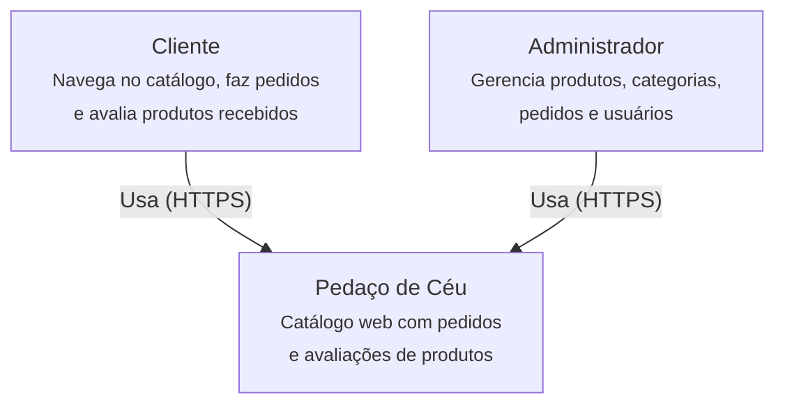
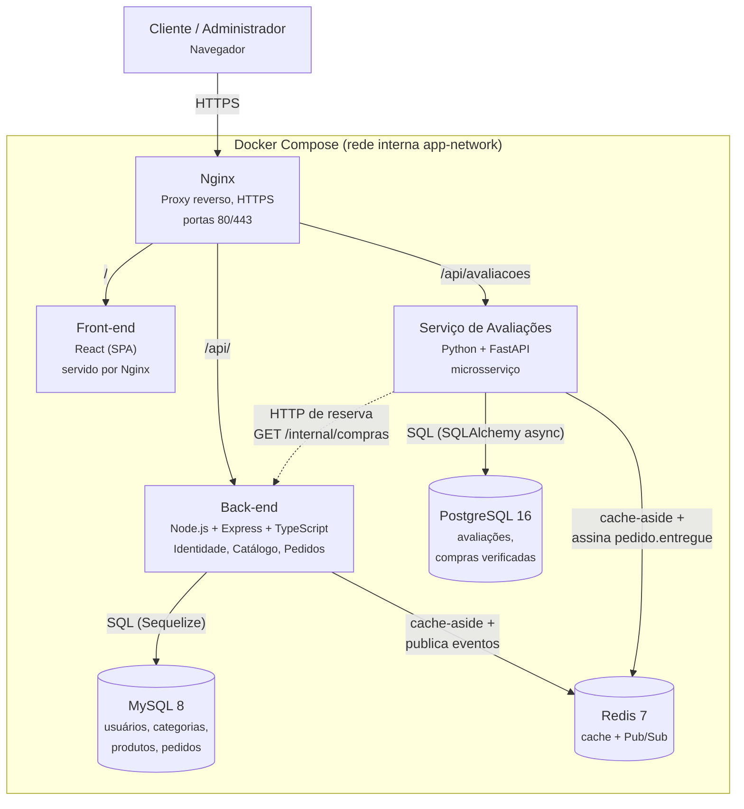

# Diagramas C4: Contexto e Containers

O modelo C4 descreve a arquitetura em níveis de zoom. Este documento cobre os dois primeiros: **Contexto** (o sistema visto de fora) e **Containers** (as aplicações e os bancos que o compõem).

## Nível 1: Contexto

O sistema não depende de serviços externos (pagamento, e-mail ou envio). As notificações de novo produto e de novo pedido são simuladas nos logs.

## Nível 2: Containers

## Responsabilidade de cada container

| Container | Tecnologia | Responsabilidade |
|---|---|---|
| Nginx | nginx:alpine | Único ponto de entrada: HTTPS, roteamento por caminho, headers de segurança, bloqueio de `/api/internal/` ([ADR 0005](adr/0005-nginx-como-ponto-unico-de-entrada.md)) |
| Front-end | React 19 | Interface do cliente e do administrador; fala só com `/api` |
| Back-end | Node.js 22, Express 5, Sequelize | Autenticação (JWT), usuários, catálogo, pedidos; publica eventos |
| Serviço de Avaliações | Python 3.13, FastAPI | Avaliações de produtos por quem recebeu o produto ([ADR 0001](adr/0001-arquitetura-microsservicos.md), [ADR 0002](adr/0002-microsservico-em-python-fastapi.md)) |
| MySQL | MySQL 8 | Dados do monólito ([ADR 0003](adr/0003-banco-de-dados-por-servico.md)) |
| PostgreSQL | PostgreSQL 16 | Dados do serviço de avaliações ([ADR 0003](adr/0003-banco-de-dados-por-servico.md)) |
| Redis | Redis 7 | Cache distribuído (com TTL) e canal de eventos ([ADR 0004](adr/0004-comunicacao-por-eventos-redis-pubsub.md)) |
