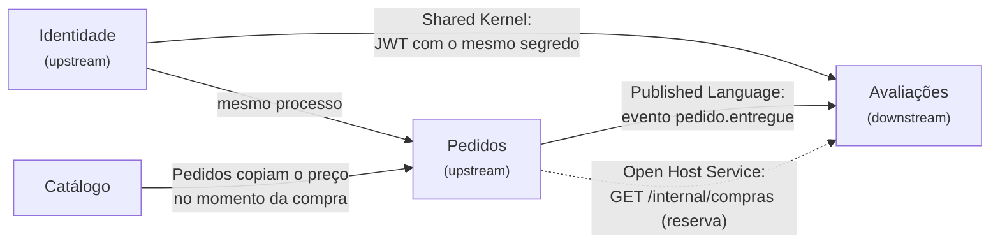

# Estilos Arquiteturais e DDD

## Estilo arquitetural

O sistema combina três estilos:

- **Monólito em camadas** no back Node (controllers → services → models), cuidando de Identidade, Catálogo e Pedidos ([ADR 0006](adr/0006-back-node-sem-camada-repository.md));
- **Microsserviço** para Avaliações, com banco próprio ([ADR 0001](adr/0001-arquitetura-microsservicos.md));
- **Orientado a eventos** na integração entre os dois, via Redis Pub/Sub ([ADR 0004](adr/0004-comunicacao-por-eventos-redis-pubsub.md)).

## Domínio e subdomínios

**Domínio:** venda de produtos por catálogo online.

| Subdomínio | Tipo | Por quê |
|---|---|---|
| **Pedidos** | Principal (*core*) | É onde está o valor do negócio: transformar interesse em venda, com regras próprias de status e permissões |
| **Catálogo** | Principal (*core*) | Sem produtos organizados e visíveis não há venda |
| **Avaliações** | De suporte (*supporting*) | Aumenta a confiança do cliente, mas o negócio funciona sem ela; tem regras específicas (só quem recebeu avalia) |
| **Identidade e acesso** | Genérico (*generic*) | Cadastro, login e papéis funcionam igual em qualquer sistema; poderia ser substituído por uma solução pronta |
| **Notificações** | Genérico (*generic*) | Hoje simuladas nos logs (`produto.criado`, `pedido.criado`) |

## Bounded Contexts

| Contexto | Onde vive | Responsabilidade | Linguagem própria |
|---|---|---|---|
| **Identidade** | Back Node | Cadastro, login, emissão do JWT, papéis `usuario` e `admin` | Usuário, papel (role), token |
| **Catálogo** | Back Node | Produtos, categorias, imagens, destaque, ativo/inativo | Produto, categoria, destaque |
| **Pedidos** | Back Node | Criação e ciclo de vida do pedido, itens e total | Pedido, item, status, entrega |
| **Avaliações** | Microsserviço Python | Avaliações com nota e comentário, resumo por produto, verificação de compra | Avaliação, nota, compra verificada, resumo |

Identidade, Catálogo e Pedidos são contextos **lógicos**: estão separados em código (controllers, services e models próprios), mas compartilham o processo e o banco do monólito. Avaliações é o único contexto separado **fisicamente**.

A mesma palavra muda de significado entre contextos. Por exemplo, "produto" no Catálogo tem nome, preço, imagem e categoria; nas Avaliações, é apenas um `produto_id` que pode ser avaliado.

## Context Map



| Relação | Padrão | Explicação |
|---|---|---|
| Identidade → Avaliações | **Shared Kernel** | Os dois compartilham o formato do JWT e o `JWT_SECRET`. O serviço de avaliações valida o token sozinho, sem chamar o back |
| Catálogo → Pedidos | **Customer/Supplier** (no mesmo processo) | O pedido consome dados do produto e guarda uma cópia do preço (`precoUnitario`), para que uma mudança de preço não altere pedidos antigos |
| Pedidos → Avaliações | **Published Language** | O evento `pedido.entregue` tem um formato fixo (envelope com `id`, `tipo`, `ocorridoEm` e `dados`), que é o contrato entre os contextos |
| Pedidos → Avaliações | **Open Host Service** | A rota interna `/internal/compras` é uma API publicada pelo back, usada só como reserva quando um evento se perde |

## Entities, Value Objects e Aggregates: contexto Pedidos

### Aggregate: Pedido

```
Pedido  (raiz do aggregate)
 ├── id, usuarioId, status, total, createdAt
 └── itens: PedidoItem[]
        └── id, produtoId, quantidade, precoUnitario
```

O **Pedido** é a raiz: toda alteração nos itens passa por ele, e nunca se grava um item isoladamente.

### Entities (têm identidade própria)

| Entity | Identidade | Observação |
|---|---|---|
| **Pedido** | `id` (UUID) | Raiz do aggregate; o mesmo pedido continua sendo ele mesmo, mesmo mudando status e itens |
| **PedidoItem** | `id` (UUID) | Entidade **interna** do aggregate: só existe dentro de um pedido e é apagada junto com ele |

### Value Objects (definidos pelo valor, sem identidade)

| Value Object | Valores e regras |
|---|---|
| **StatusPedido** | `pendente`, `confirmado`, `entregue` ou `cancelado` |
| **Preço / Dinheiro** | `total` e `precoUnitario`: valores não negativos; o `precoUnitario` é um retrato do preço no momento da compra |
| **Quantidade** | Inteiro, no mínimo 1 |
| **Referências** | `usuarioId` e `produtoId`: o pedido aponta para outros aggregates **só pelo id**, nunca pelo objeto inteiro |

No código atual, esses value objects são tipos simples (ENUM, FLOAT, INTEGER) validados nos DTOs e no service, sem classes próprias.

### Regras (invariantes) que o aggregate garante

1. O `total` é sempre a soma de `quantidade × precoUnitario` dos itens.
2. Pedido e itens são gravados na mesma transação: tudo ou nada.
3. Um cliente comum só cria pedidos como `pendente` (impede criar um pedido já "entregue" para ganhar o direito de avaliar).
4. Um cliente comum só pode mudar o status de `confirmado` para `entregue` e não pode alterar os itens; as demais mudanças são do administrador.
5. Ao passar para `entregue`, o pedido emite o **evento de domínio** `pedido.entregue`, depois do commit.

### Bônus: aggregate Avaliação (contexto Avaliações)

- **Entity/raiz:** `Avaliacao` (id, produto_id, usuario_id, autor_nome, nota, comentário, datas).
- **Value Object:** `Nota`, um inteiro de 1 a 5 (garantido por `CHECK` no banco).
- **Invariante:** uma avaliação por cliente e produto (`UNIQUE (usuario_id, produto_id)`), e só de quem tem uma `CompraVerificada`.
