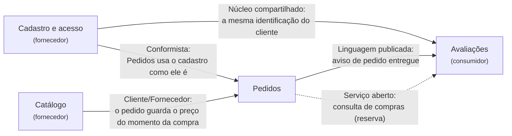

# Domínio, Contextos e Modelo do Negócio (DDD)

Este documento descreve o negócio do Pedaço de Céu na linguagem de quem vende, compra e administra a loja. Ele não depende de tecnologia: poderia ser lido por um cliente, pelo financeiro ou por um gestor. A ligação com o código fica no [anexo técnico](#anexo-técnico-estilos-arquiteturais-e-ligação-com-o-código), no fim.

## Domínio e subdomínios

**Domínio:** venda de produtos por catálogo online.

| Subdomínio | Tipo | Por quê |
|---|---|---|
| **Pedidos** | Principal | É onde a loja ganha dinheiro: transformar o interesse do cliente em venda, com regras próprias de andamento e de quem pode fazer o quê |
| **Catálogo** | Principal | Sem produtos organizados e visíveis não há venda |
| **Avaliações** | De suporte | Aumenta a confiança de quem vai comprar, mas a loja vende sem ela. Tem regras próprias: só avalia quem recebeu o produto |
| **Cadastro e acesso** | Genérico | Cadastro, entrada e permissões funcionam igual em qualquer loja; poderia ser substituído por uma solução pronta |
| **Notificações** | Genérico | Avisos de novo produto e de novo pedido. Hoje são apenas registrados internamente, sem envio ao cliente |

## Linguagem do negócio

Termos que a equipe e o negócio usam com o mesmo significado, em conversas, documentos e no sistema.

| Termo | Significado |
|---|---|
| **Cliente** | Pessoa cadastrada que navega no catálogo, faz pedidos e avalia produtos |
| **Administrador** | Pessoa da loja que cuida de produtos, categorias, pedidos e cadastros |
| **Produto** | Item à venda, com nome, preço, imagem, descrição e categoria |
| **Categoria** | Grupo que organiza os produtos no catálogo |
| **Destaque** | Produto que a loja escolheu para aparecer em evidência |
| **Pedido** | Compra feita por um cliente, com um ou mais itens e um valor total |
| **Item do pedido** | Um produto dentro do pedido, com a quantidade e o preço pago |
| **Situação do pedido** | Em que ponto o pedido está: pendente, confirmado, entregue ou cancelado |
| **Entrega** | Momento em que o cliente confirma que recebeu o pedido |
| **Avaliação** | Opinião de um cliente sobre um produto que recebeu, com nota e comentário |
| **Nota** | Valor de 1 a 5 dado na avaliação |
| **Compra verificada** | Registro de que um cliente recebeu um produto; é o que dá o direito de avaliar |
| **Resumo de avaliações** | Média das notas e total de avaliações de um produto |

## Contextos delimitados (Bounded Contexts)

Cada contexto é uma área do negócio com responsabilidades e vocabulário próprios.

| Contexto | Responsabilidade | Vocabulário próprio |
|---|---|---|
| **Cadastro e acesso** | Cadastrar clientes, permitir a entrada no sistema e separar o que cada perfil (cliente ou administrador) pode fazer | Cliente, administrador, perfil |
| **Catálogo** | Manter os produtos e as categorias, decidir o que está à venda e o que fica em destaque | Produto, categoria, destaque |
| **Pedidos** | Registrar as compras e acompanhar cada pedido do início até a entrega | Pedido, item, situação, entrega |
| **Avaliações** | Receber as opiniões dos clientes, garantir que só quem recebeu avalia e mostrar o resumo de cada produto | Avaliação, nota, compra verificada, resumo |

A mesma palavra muda de significado entre contextos. "Produto", no Catálogo, tem nome, preço, imagem e categoria. Em Avaliações, é apenas algo que pode receber notas: o preço e a imagem não importam ali.

## Mapa de contextos (Context Map)



| Relação | Padrão | Explicação |
|---|---|---|
| Cadastro e acesso → Avaliações | **Núcleo compartilhado** (*Shared Kernel*) | Os dois contextos reconhecem o cliente da mesma forma. Avaliações sabe quem é o cliente sem precisar perguntar ao Cadastro a cada avaliação |
| Cadastro e acesso → Pedidos | **Conformista** (*Conformist*) | Pedidos adota o cadastro do cliente exatamente como ele é, sem criar uma versão própria |
| Catálogo → Pedidos | **Cliente/Fornecedor** (*Customer/Supplier*) | O pedido usa os produtos do Catálogo e guarda uma cópia do preço no momento da compra. Se o preço mudar depois, os pedidos antigos continuam com o valor que o cliente pagou |
| Pedidos → Avaliações | **Linguagem publicada** (*Published Language*) | Quando um pedido é entregue, Pedidos avisa Avaliações. O aviso tem um formato combinado entre as áreas: qual aviso é, quando aconteceu, qual pedido, qual cliente e quais produtos |
| Pedidos → Avaliações | **Serviço aberto** (*Open Host Service*) | Se um aviso de entrega se perder, Avaliações pode perguntar a Pedidos se aquele cliente recebeu aquele produto. É um caminho de reserva, usado só nesse caso |

## Acontecimentos do negócio (eventos de domínio)

| Acontecimento | Quando ocorre | Quem se interessa |
|---|---|---|
| **Produto criado** | O administrador cadastra um produto novo | Notificações |
| **Pedido criado** | Um cliente fecha um pedido | Notificações |
| **Pedido entregue** | O cliente confirma o recebimento | Avaliações, que passa a permitir que o cliente avalie os produtos daquele pedido |

## Modelo do contexto Pedidos

### Agregado: Pedido

```
Pedido  (raiz do agregado)
 ├── código, cliente, situação, valor total, data
 └── itens: Item do pedido[]
        └── código, produto, quantidade, preço pago
```

O **Pedido** é a raiz: toda mudança nos itens passa por ele, e um item nunca é registrado sozinho.

### Entidades (têm identidade própria)

| Entidade | Identidade | Observação |
|---|---|---|
| **Pedido** | Código único | O mesmo pedido continua sendo ele mesmo, mesmo quando a situação e os itens mudam |
| **Item do pedido** | Código único | Só existe dentro de um pedido e é apagado junto com ele |

### Objetos de valor (definidos pelo valor, sem identidade)

| Objeto de valor | Valores e regras |
|---|---|
| **Situação do pedido** | Pendente, confirmado, entregue ou cancelado |
| **Valor em dinheiro** | Valor total e preço pago: nunca negativos. O preço pago é um retrato do preço no momento da compra |
| **Quantidade** | Número inteiro, no mínimo 1 |
| **Referências** | O pedido aponta para o cliente e para os produtos apenas pelo código, sem copiar o cadastro inteiro |

### Regras que o agregado sempre garante (invariantes)

1. O valor total é sempre a soma de quantidade × preço pago de todos os itens.
2. Um pedido nunca fica registrado pela metade: ou é registrado com todos os itens, ou não é registrado.
3. Um cliente só cria pedidos na situação "pendente". Isso impede que alguém crie um pedido já "entregue" para ganhar o direito de avaliar.
4. Um cliente só pode passar o próprio pedido de "confirmado" para "entregue" e não pode alterar os itens. As demais mudanças são do administrador.
5. Quando o pedido passa a "entregue", Pedidos avisa Avaliações, sempre depois de a entrega estar registrada.

## Modelo do contexto Avaliações

- **Entidade e raiz do agregado:** Avaliação (código, produto, cliente, nome do autor, nota, comentário, datas).
- **Objeto de valor:** Nota, um número inteiro de 1 a 5.
- **Regras (invariantes):**
    1. Cada cliente avalia cada produto uma única vez; para mudar de opinião, edita a avaliação que já fez.
    2. Só avalia quem tem uma compra verificada daquele produto.
    3. O cliente só edita ou remove a própria avaliação. O administrador pode remover qualquer uma (moderação).

---

## Anexo técnico: estilos arquiteturais e ligação com o código

Esta seção é para a equipe de desenvolvimento. Ela mostra como o modelo acima foi implementado, para que cada conceito possa ser encontrado no código.

### Estilos arquiteturais

O sistema combina três estilos:

- **Monólito em camadas** no back Node (controllers → services → models), com os contextos Cadastro e acesso, Catálogo e Pedidos ([ADR 0006](adr/0006-back-node-sem-camada-repository.md));
- **Microsserviço** para Avaliações, com banco próprio ([ADR 0001](adr/0001-arquitetura-microsservicos.md));
- **Orientado a eventos** na integração entre os dois, via Redis Pub/Sub ([ADR 0004](adr/0004-comunicacao-por-eventos-redis-pubsub.md)).

### Onde cada contexto vive

| Contexto | Implementação | Dados |
|---|---|---|
| Cadastro e acesso | Back Node (`auth`, `usuario`) | MySQL |
| Catálogo | Back Node (`produto`, `categoria`) | MySQL |
| Pedidos | Back Node (`pedido`) | MySQL |
| Avaliações | Microsserviço Python/FastAPI | PostgreSQL ([ADR 0003](adr/0003-banco-de-dados-por-servico.md)) |

Cadastro e acesso, Catálogo e Pedidos são contextos **lógicos**: separados em código (controllers, services e models próprios), mas no mesmo processo e no mesmo banco. Avaliações é o único contexto separado **fisicamente**.

### Relações do mapa de contextos no código

| Relação | Implementação |
|---|---|
| Núcleo compartilhado | Os dois serviços usam o mesmo formato de JWT e o mesmo `JWT_SECRET`; o serviço de avaliações valida o token sozinho (`app/auth.py`) |
| Conformista | O pedido guarda o `usuarioId` do usuário autenticado (`services/pedido.service.ts`) |
| Cliente/Fornecedor | O pedido busca o preço no banco e grava em `precoUnitario` (`services/pedido.service.ts`) |
| Linguagem publicada | Evento `pedido.entregue` no Redis Pub/Sub, com envelope `id`, `tipo`, `ocorridoEm` e `dados` (`infra/eventos.ts` publica; `app/events/assinante.py` consome e grava em `compras_verificadas`) |
| Serviço aberto | Rota interna `GET /internal/compras`, protegida por `X-Internal-Token` e bloqueada no Nginx (`app/clients/pedidos_client.py` chama) |

### Modelo no código

- Os objetos de valor do Pedido são tipos simples (ENUM, FLOAT, INTEGER) validados nos DTOs e no service, sem classes próprias.
- As identidades são UUIDs.
- As regras da Avaliação também são garantidas no banco: `CHECK (nota BETWEEN 1 AND 5)` e `UNIQUE (usuario_id, produto_id)`.
